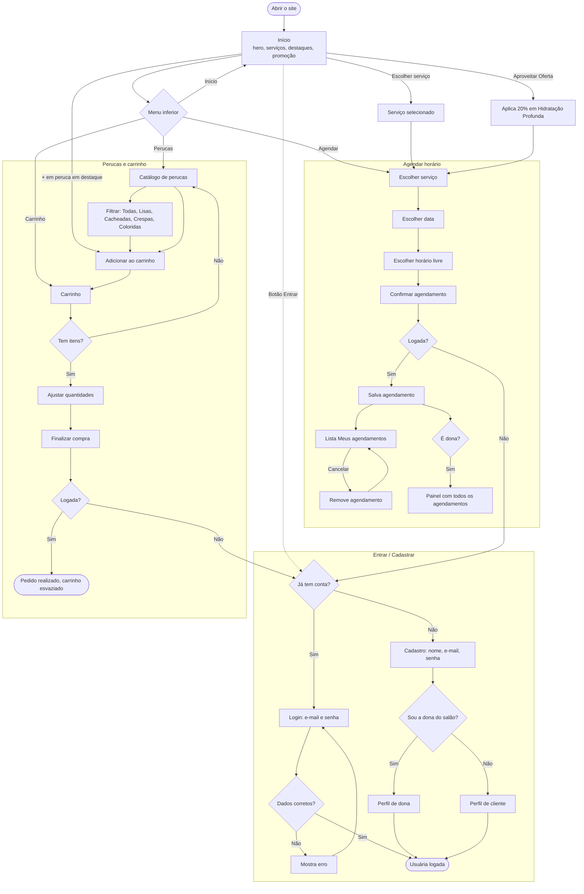
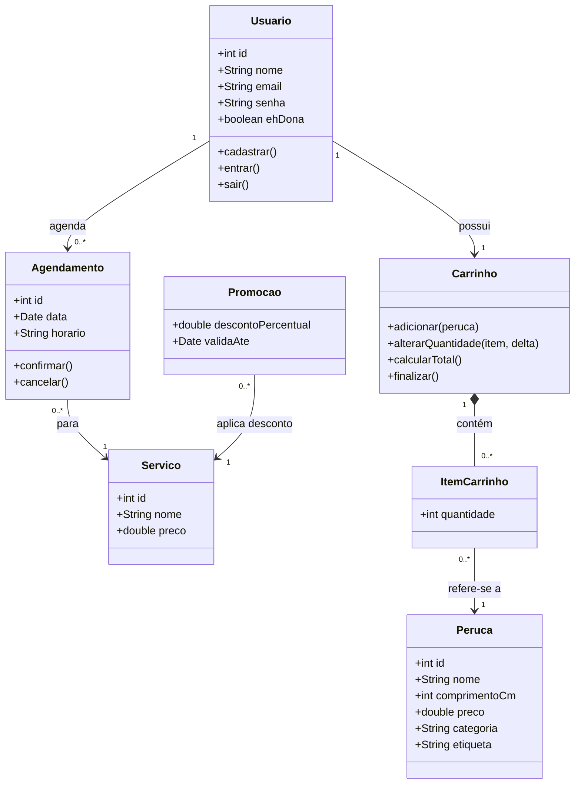
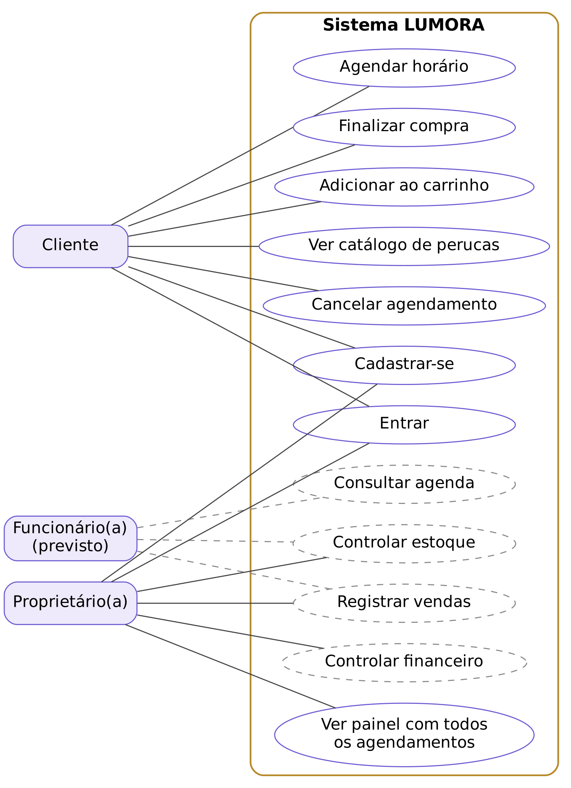
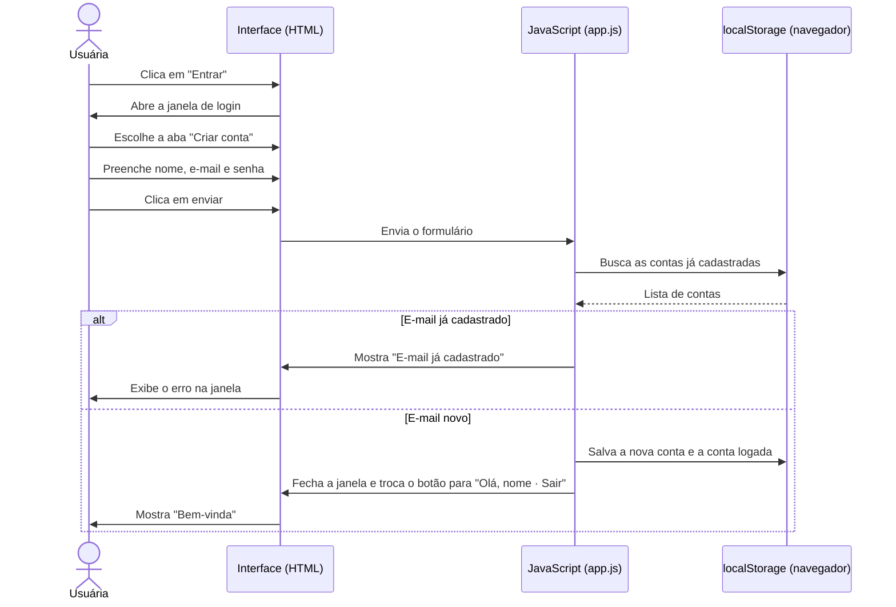
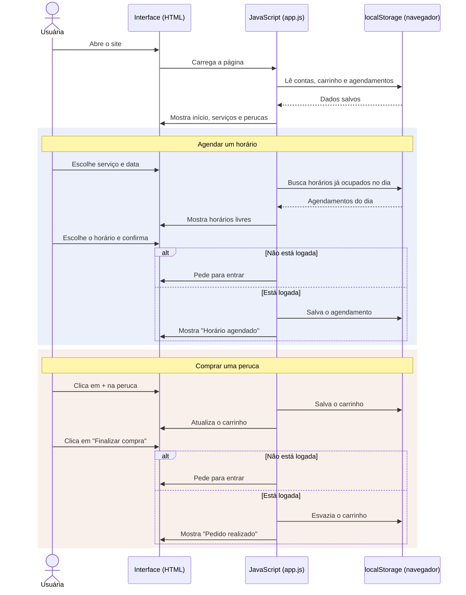

<div align="center">

# 💎 LUMORA

**Gestão de salão de beleza e venda de produtos em uma única plataforma.**


*ProjectGuilda-JLLPV · Projeto da disciplina de Engenharia de Software/ P.I*

</div>

---

## 📑 Sumário

- [Sobre o projeto](#-sobre-o-projeto)
- [Objetivos](#-objetivos)
- [Funcionalidades](#-funcionalidades)
- [Tecnologias](#%EF%B8%8F-tecnologias)
- [Estrutura do repositório](#-estrutura-do-repositório)
- [Como executar](#-como-executar)
- [Documentação e design](#-documentação-e-design)
- [Diagramas](#%EF%B8%8F-diagramas)
- [Equipe](#-equipe)

---

## 📖 Sobre o projeto

A **LUMORA** é um aplicativo para o gerenciamento de um salão de beleza. A plataforma reúne, em um só lugar, a organização dos atendimentos, o agendamento de horários e a comercialização de produtos.

A solução busca trazer **praticidade e eficiência** tanto para a profissional, que passa a controlar sua agenda e suas vendas, quanto para as clientes, que agendam serviços e escolhem produtos de forma simples.

O projeto foi desenvolvido na disciplina de **Engenharia de Software**, com o propósito de aplicar na prática os conceitos vistos em aula.

## 🎯 Objetivos

**Objetivo geral:** desenvolver uma solução tecnológica que contribua para a organização e a eficiência na gestão do salão, facilitando o controle da agenda e dos atendimentos e oferecendo um canal adequado para divulgar e vender perucas naturais.

**Objetivos específicos:**

- Aplicar conceitos de Engenharia de Software;
- Trabalhar em equipe;
- Utilizar ferramentas de desenvolvimento;
- Organizar e documentar o projeto;
- Desenvolver a solução seguindo boas práticas de programação.

## ✨ Funcionalidades

| Funcionalidade | Descrição | Protótipo |
|---|---|:---:|
| Cadastro de usuários | Criação de conta por clientes e pelo dono(a) do estabelecimento | ✅ |
| Login de usuários | Acesso à conta para agendar e comprar | ✅ |
| Agendamento de horários | Escolha de serviço, data e horário disponível | ✅ |
| Cadastro do dono/dona | Perfil com painel para acompanhar todos os agendamentos | ✅ |
| Carrinho de compras | Adição de perucas, ajuste de quantidades e finalização | ✅ |
| Catálogo de perucas | Listagem com filtros por tipo (lisas, cacheadas, crespas, coloridas) | ✅ |

> O protótipo atual é navegável e usa o `localStorage` do navegador para simular dados. A integração com back-end está prevista para as próximas etapas.

## 🛠️ Tecnologias

| Tecnologia | Uso no projeto |
|---|---|
| **HTML** | Estruturação das páginas |
| **CSS** | Estilização e layout |
| **JavaScript** | Lógica e interatividade |
| **Git** | Controle de versão |
| **GitHub** | Hospedagem e colaboração |

## 📂 Estrutura do repositório

```text
ProjectGuilda-JLLPV/
├── index.html          # Páginas e telas
├── style.css           # Estilos
├── app.js              # Lógica da aplicação
├── Links/              # Diagramas (classes, fluxograma, caso de uso e sequência)
└── README.md
```

## ▶️ Como executar

```bash
# 1. Clone o repositório
git clone https://github.com/WhitemanKMKZ/ProjectGuilda-JLLPV.git

# 2. Acesse a pasta do projeto
cd ProjectGuilda-JLLPV

# 3. Abra o protótipo no navegador
#    (dê um duplo clique em index.html)
```

Sem Git instalado? No GitHub, use o botão verde **Code → Download ZIP**, extraia a pasta e abra o `index.html`.

Não é necessário instalar dependências.

## 🔗 Documentação e design

| Recurso | Link |
|---|---|
| 🎨 Interface (canva) | [Protótipo da interface Lumora](https://canva.link/l64kext3h0x9wm0) |
| 🧩 Diagrama de classes | [Ver diagrama](Links/diagrama-classes.md) |
| 🔀 Fluxograma do site | [Ver fluxograma](Links/fluxograma.md) |
| 👥 Diagrama de caso de uso | [Ver diagrama](Links/diagrama-caso-de-uso.md) |
| 🔁 Sequência – criação de conta | [Ver diagrama](Links/diagrama-sequencia-conta.md) |
| 🔁 Sequência – fluxo geral | [Ver diagrama](Links/diagrama-sequencia-geral.md) |
| 📊 Planilha do projeto | [Google Planilhas](https://docs.google.com/spreadsheets/d/12rvJE7hvHuAYC0oeSAkxiAsvCnfeRgqhElNUBJeFJPk/edit?gid=0#gid=0) |

## 🗺️ Diagramas

Clique em cada título para abrir o diagrama aqui mesmo (o GitHub desenha sozinho).

<details>
<summary><b>Fluxograma do site</b></summary>



</details>

<details>
<summary><b>Diagrama de classes</b></summary>



</details>

<details>
<summary><b>Diagrama de caso de uso</b></summary>

Linhas tracejadas = funcionalidades previstas, ainda não feitas no protótipo.



</details>

<details>
<summary><b>Diagrama de sequência – criação de conta</b></summary>



</details>

<details>
<summary><b>Diagrama de sequência – fluxo geral (agendar e comprar)</b></summary>



</details>

---

## 👥 Equipe

| Integrante | Função |
|---|---|
| **Jose Gonçalves Pereira Neto** | Back-end |
| **Leonardo Henrique Alves** | Front-end |
| **Leonardo Jose Tebar** | _A definir_ |
| **Pedro Henrique De Souza** | _A definir_ |
| **Vitor Yuri Hirose Pena** | _A definir_ |

---

<div align="center">

Projeto acadêmico · Engenharia de Software

</div>
